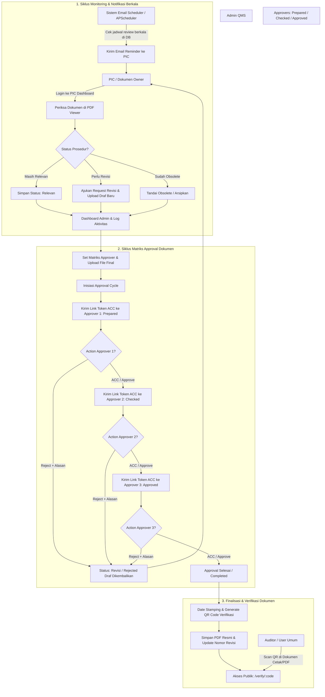
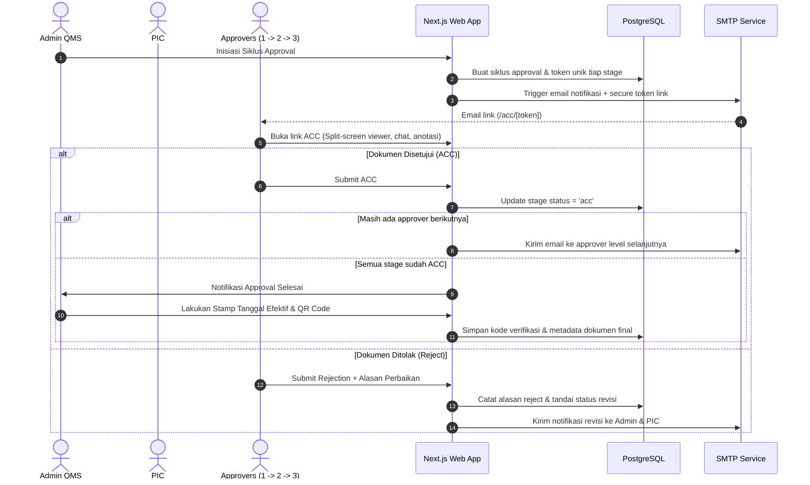

# Workflow Sistem Review Prosedur (QMS)

Dokumen ini mendefinisikan alur kerja (*workflow*) menyeluruh pada sistem Review Prosedur QMS, mencakup siklus review berkala, matriks approval bertingkat (*sequential approval*), hingga stempel tanggal dan verifikasi QR Code.

---

## 1. End-to-End Workflow Diagram

---

## 2. Sequence Diagram Approval & Verifikasi

---

## 3. Matriks Aktor & Peran

| Aktor | Peran & Hak Akses |
|---|---|
| **Admin QMS** | Monitoring keseluruhan status dokumen, kelola departemen, setup matriks approval, date stamping, arsip dokumen |
| **PIC / Owner** | Review dokumen tahunan/berkala, ajukan revisi, upload draf dokumen baru |
| **Approver 1 (Prepared)** | Review draf teknis awal melalui tautan aman ber-token (`/acc/:token`) |
| **Approver 2 (Checked)** | Verifikasi kesesuaian prosedur dan standar kerja |
| **Approver 3 (Approved)** | Pengesahan akhir manajemen sebelum prosedur berlaku |
| **Auditor / Verifier** | Verifikasi keaslian dokumen via QR Code (`/verify/:code`) tanpa perlu login |
